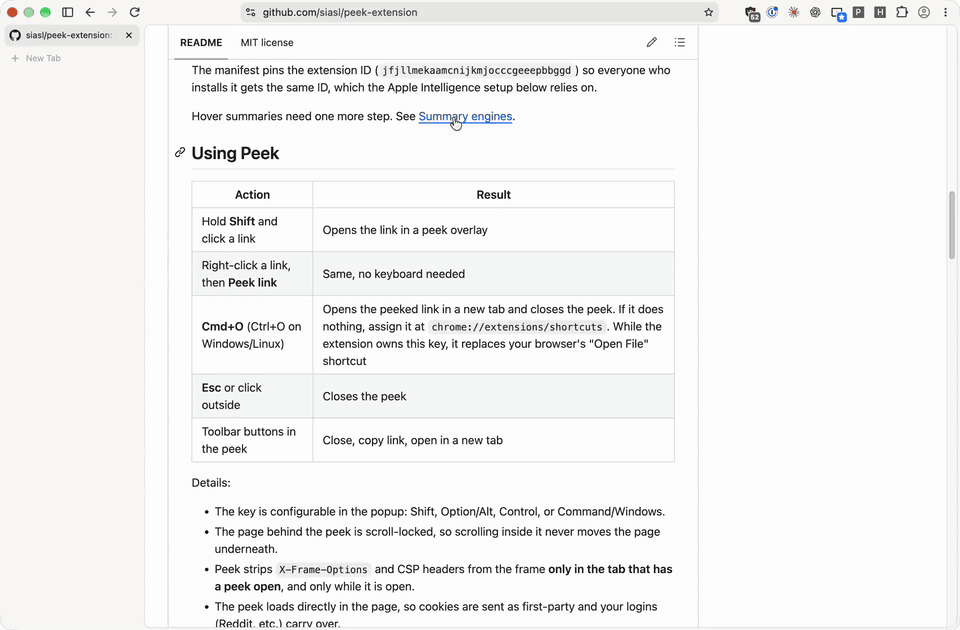
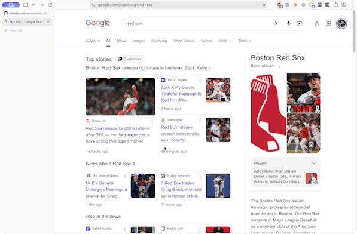
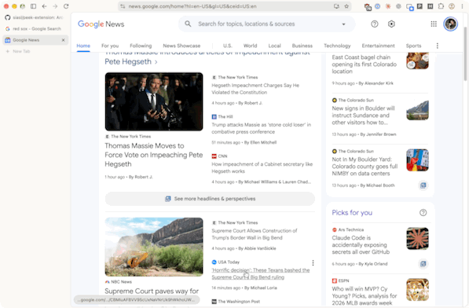

# Peek

A Chrome/Chromium extension (tested in Helium) that brings Arc-style **Peek** and **link summaries** to any browser.

- **Peek**: preview a link in an overlay without leaving the page. Works on sites that normally refuse to be framed, and keeps you logged in.
- **Hover summaries**: hover a link to get a short on-device summary with a thumbnail, like Arc's "5 second previews".
- **Never triggered by dragging.** Peek only opens from a modifier-click or the right-click menu.



*Prefer a sharper version? [Watch the video](docs/media/peek-demo.mp4) (30 seconds, 2 MB).*

## Install

Peek isn't on the Chrome Web Store, so you load it as an unpacked extension. It needs Chrome 116 or newer, or a Chromium browser based on it (Helium, Brave, Edge, Arc and others).

1. **Get the code.** Either:
   - clone it: `git clone https://github.com/siasl/peek-extension.git`, or
   - click **Code → Download ZIP** on the [GitHub page](https://github.com/siasl/peek-extension) and unzip it.

   Keep the folder somewhere permanent. The browser loads the extension from it every time it starts, so deleting or moving the folder breaks the extension.
2. Open `chrome://extensions` in your browser (Brave: `brave://extensions`, Edge: `edge://extensions`) and turn on **Developer mode**, usually a toggle in the top right.
3. Click **Load unpacked** and choose the **`extension`** folder inside `peek-extension` (the one that contains `manifest.json`), not the top-level folder.
4. Click the puzzle-piece icon in the toolbar and pin **Peek** so its settings popup is one click away.
5. Reload any pages that were already open. The extension only affects pages loaded after it was installed.

To try it: hold **Shift** and click a link. A preview should open over the page.

**Updating:** run `git pull` (or download the ZIP again), then click the reload icon on Peek's card at `chrome://extensions`.

The manifest pins the extension ID (`jfjllmekaamcnijkmjocccgeeepbbggd`) so everyone who installs it gets the same ID, which the Apple Intelligence (apfel) setup below relies on.

Hover summaries need one more step. See [Summary engines](#summary-engines).

## Using Peek

| Action | Result |
| --- | --- |
| Hold **Shift** and click a link | Opens the link in a peek overlay |
| Right-click a link, then **Peek link** | Same, no keyboard needed |
| **Cmd+O** (Ctrl+O on Windows/Linux) | Opens the peeked link in a new tab and closes the peek. If it does nothing, assign it at `chrome://extensions/shortcuts`. While the extension owns this key, it replaces your browser's "Open File" shortcut |
| **Esc** or click outside | Closes the peek |
| Toolbar buttons in the peek | Close, copy link, open in a new tab |

Details:

- The key is configurable in the popup: Shift, Option/Alt, Control, or Command/Windows.
- The page behind the peek is scroll-locked, so scrolling inside it never moves the page underneath.
- Peek strips `X-Frame-Options` and CSP headers from the frame **only in the tab that has a peek open**, and only while it is open.
- The peek loads directly in the page, so cookies are sent as first-party and your logins (Reddit, etc.) carry over.
- On **Google News**, links open the real article instead of the Google News redirect page.

## Hover summaries

Hover a link for a moment and a card appears with the page's thumbnail, title and a short summary.

### When summaries appear

Set this in the toolbar popup:

| Mode | Behavior |
| --- | --- |
| **On search pages only** (default) | Google, Bing, DuckDuckGo, Brave, Kagi, Ecosia, Yahoo, Startpage, Yandex and Google News |
| **On all sites** | Every link, on every site |
| **Off** | No summaries |

On a search page, just hover a link:



On any other site, **hold Shift while hovering** a link to summarize it, even in "search pages only" mode:



Pressing Shift while already resting on a link works too. Scrolling, clicking or pressing another key dismisses the card.

The hover delay can be set to 0.4s, 0.7s (default) or 1.2s.

### Summary engines

Pick the engine in the popup:

| Engine | What it is |
| --- | --- |
| **Local server, then Chrome** (default) | Tries your local model server first, then Chrome's built-in model if available |
| **Local server only** | Any server with an OpenAI-compatible API: [apfel](https://apfel.franzai.com) (Apple Intelligence), [Ollama](https://ollama.com), [LM Studio](https://lmstudio.ai), llama.cpp and similar |
| **Chrome on-device only** | Uses Chrome's Gemini Nano through the Summarizer API |

Under **Local server** in the popup, choose a preset (Apple Intelligence, Ollama, LM Studio) or **Custom**, and set the address and model name. The popup checks the connection as you type and lists the models the server has. Apple Intelligence is just one preset, so every server works the same way.

The address can be any computer you can reach, such as `192.168.1.20:11434` for a model server running elsewhere on your network. You can leave off `http://` and `/v1`.

Page text goes only to the server you set (or to Chrome's built-in model). The popup warns you when that server isn't on your own computer.

#### Ollama

1. Install [Ollama](https://ollama.com) and pull a model, for example `ollama pull llama3.2`.
2. Let the extension talk to it. Ollama rejects browser extensions by default, so set this and restart Ollama:
   - Mac app: `launchctl setenv OLLAMA_ORIGINS "chrome-extension://*"`, then quit and reopen Ollama.
   - Command line: `OLLAMA_ORIGINS="chrome-extension://*" ollama serve`
   - Server on another machine: also set `OLLAMA_HOST=0.0.0.0` there so it accepts connections from your network.
3. In the Peek popup, choose the **Ollama** preset (`http://127.0.0.1:11434/v1`), and pick your model in the model box.

#### LM Studio

1. In LM Studio, load a model, open the **Developer** tab and start the server (default port 1234).
2. In the server settings, turn on **Enable CORS**. For a server on another machine, turn on serving on the local network.
3. In the Peek popup, choose the **LM Studio** preset (`http://127.0.0.1:1234/v1`), and pick the model in the model box.

Smaller models vary in how well they follow the summary prompt. If summaries ramble, try a different model or edit the prompt (see [Changing the summary style](#changing-the-summary-style)).

#### Apple Intelligence setup (macOS)

Requires a Mac with Apple Intelligence turned on (System Settings → Apple Intelligence & Siri) and [Homebrew](https://brew.sh). Run these from the `peek-extension` folder:

```bash
brew install apfel
./apfel/install-service.sh
```

The script installs a login item (a LaunchAgent named `com.peek.apfel`) that starts apfel automatically at login and keeps it running. It listens only on `http://127.0.0.1:11434`, so other computers can't reach it, and it accepts requests only from this extension. Read the script first if you like. It's short.

Open the toolbar popup afterwards and choose the **Apple Intelligence (apfel)** preset. The status line should say "Connected." If it can't reach the server, see [Troubleshooting](#troubleshooting).

To remove it:

```bash
launchctl bootout gui/$(id -u)/com.peek.apfel && rm ~/Library/LaunchAgents/com.peek.apfel.plist
```

#### Chrome on-device setup

This works in Google Chrome 138+, not in Helium or other Chromium builds that cannot download Gemini Nano. The popup detects which browser you're using and, if Chrome's model isn't available, hides this setup and points you to a local server instead. Open the popup and click **Enable summaries** to download the model once. Peek only uses Chrome's model if it is already downloaded.

### Changing the summary style

The prompt lives in `extension/background.js` as `SUMMARY_PROMPT`. Page text is trimmed to 6,000 characters and the answer is capped at 250 tokens (`max_tokens` in `streamChat`), so raise those if summaries get cut off. Apple's model has a 4,096-token context window, so keep input modest. Models with larger context windows (most Ollama and LM Studio models) can take more.

### What the card shows when a page can't be read

- Some sites block automated fetches (bot protection, paywalls). Peek never tries to evade this.
- On search pages, it falls back to the snippet the search engine already shows for that result.
- Otherwise the card says it couldn't load the page.
- Summaries are fetched without your cookies, so hovering never touches your logged-in sessions.

## Troubleshooting

| Problem | Try this |
| --- | --- |
| Shift-click does nothing | Reload the page. Check the site isn't in "Disable on these sites". Pages like `chrome://` and the Chrome Web Store can't run extensions. |
| A site shows a login page or blank page in the peek | Some sites need their login cookies, which browsers don't send inside a frame on a different site (Instagram and X are examples). Add the site to "Open in a new tab instead of a peek" in the popup. |
| Popup says "Can't reach" the server | Make sure the server is running and the address is right. For apfel, run `./apfel/install-service.sh` and check `~/Library/Logs/peek-apfel.log`. For Ollama and LM Studio, see their setup sections above. |
| apfel won't start, or the port is in use | apfel and Ollama both default to port 11434, so they can't run at the same time. Quit one, or start one on another port and enter that address in the popup. |
| Popup says the server refused the request (403) | The server is blocking browser extensions. Ollama: set `OLLAMA_ORIGINS=chrome-extension://*`. LM Studio: turn on Enable CORS. apfel: the extension ID differs from the one the script allowed, so make sure `extension/manifest.json` still contains its `key` and run the install script again. |
| Popup says the server has no model with that name | Pick a model from the dropdown in the model box. For Ollama, run `ollama list` to see what's installed. |
| "No summary engine is available" | Set up a local server above, or use Chrome's built-in model in Chrome 138+. |
| Summaries get cut off | See [Changing the summary style](#changing-the-summary-style). |

## Privacy

- Link summaries run on models you control. The page text goes only to the server address you enter in the popup (by default apfel on `127.0.0.1`) or to Chrome's own built-in model. Nothing is sent to an AI service on the internet unless you point the address at one, and the popup warns you if the server isn't on your own computer.
- To summarize a link, the extension downloads that page itself, without your cookies. This is the same request your browser would make if you visited the link.
- For Google News links, it contacts `news.google.com` to find the original article, using your normal Google session.
- Settings are stored in your browser's sync storage. The extension has no analytics, accounts or servers.

## Settings

Click the toolbar icon to open the popup:

- Peek modifier key
- Summary mode, hover delay and engine
- Local server preset, address and model, with a live connection check, plus the Chrome model download
- **Open in a new tab instead of a peek**: one domain per line, subdomains included. Defaults to `instagram.com` and `x.com`, which don't work well in a frame
- **Disable on these sites**: one domain per line, subdomains included

Settings sync through `chrome.storage.sync`.

## Files

Everything the browser loads lives in `extension/`. The rest of the repo is optional setup and documentation.

| File | Purpose |
| --- | --- |
| `extension/manifest.json` | MV3 manifest |
| `extension/background.js` | Header stripping, page fetching, streaming summaries from the model server, context menu |
| `extension/content.js` | Click handling and the peek overlay |
| `extension/summary.js` | Hover handling and the summary card |
| `extension/extract.js` | Pulls readable text, title and image from fetched HTML |
| `extension/gnews.js` | Resolves Google News links to the original article |
| `extension/peek.html`, `extension/peek.js` | Fallback frame used when a page's CSP blocks direct framing |
| `extension/options.html`, `extension/options.js` | Toolbar popup |
| `extension/icons/` | Toolbar and store icons (source: `docs/icon.svg`) |
| `apfel/install-service.sh` | Optional LaunchAgent for Apple Intelligence |
| `docs/media/` | Demo video and GIFs used in this README (not part of the extension) |

## Permissions

- `declarativeNetRequest`: strips framing headers in the tab with an open peek
- `contextMenus`: the "Peek link" menu item
- `storage`: your settings
- `<all_urls>`: lets peek work on any site and lets the extension fetch pages for summaries

## License

MIT. See [LICENSE](LICENSE).
